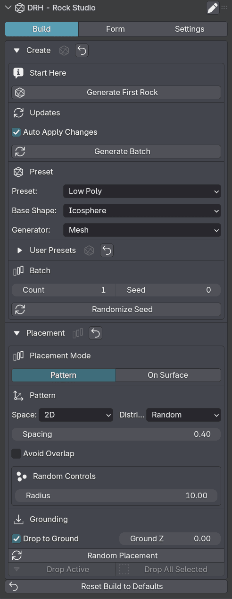

# DRH - Rock Studio

**Rocks are the thing everyone needs and nobody wants to model. This one builds them.**

  

 

## Where this stands

The add-on is built to v1.0.0 and development is paused while the released DRH add-ons get their updates. There is no public download from this repository, and I'm not going to post a release date I can't hold.

What you can do here: read what it does, look at the screenshots, and tell me in an issue whether you'd use it. Demand is the only thing that moves a paused add-on back into the queue.

## What it does

Procedural rock generation across Mesh and Geometry Nodes workflows, with advanced distribution and surface scatter tools. You set the shape language and the scatter, and the result stays editable instead of becoming a sculpt you can't re-aim.

## Who it's for

Environment artists filling terrain without a sculpting pass. Prop and kit artists who need 40 variations from one setup. Anyone building a rock wall, a shoreline, or a desert floor on a deadline.

## Why it's paused, honestly

Released tools with open issues come first. Rock Studio works, but it hasn't been through the compatibility pass that released add-ons get, and shipping an add-on without that pass is how you get a support load instead of a product.

[Open an issue](https://github.com/pacosalasv/DRH_Rock_Studio-Support/issues) if you want it moved up. Say what you'd use it for; that's more useful than a thumbs up.

Released DRH add-ons, all free: [Blender tools on BlendKit](https://www.blendkit.com/?query=category_subtree:addon+author_id:205846) · [DRH Hub](https://github.com/pacosalasv/DRH_Addons_Hub)

  

